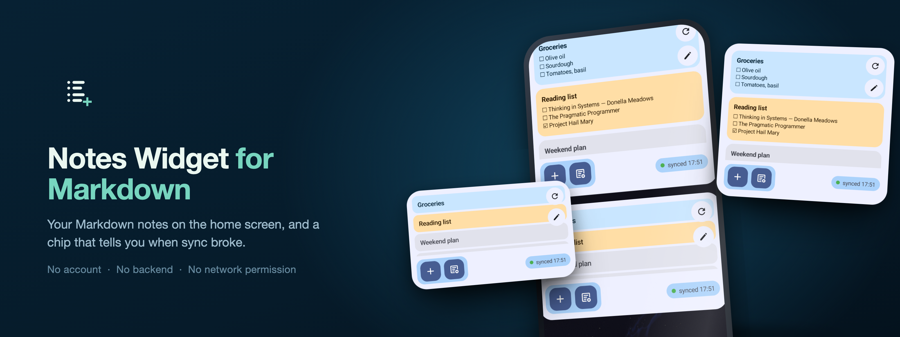
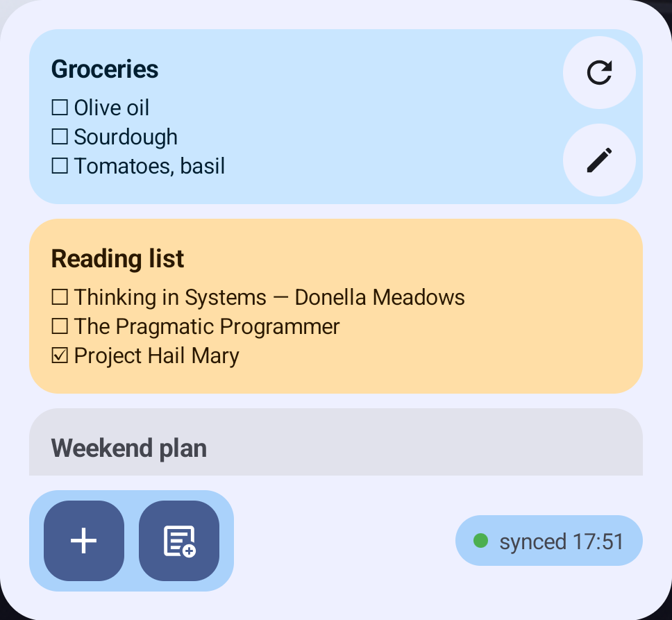
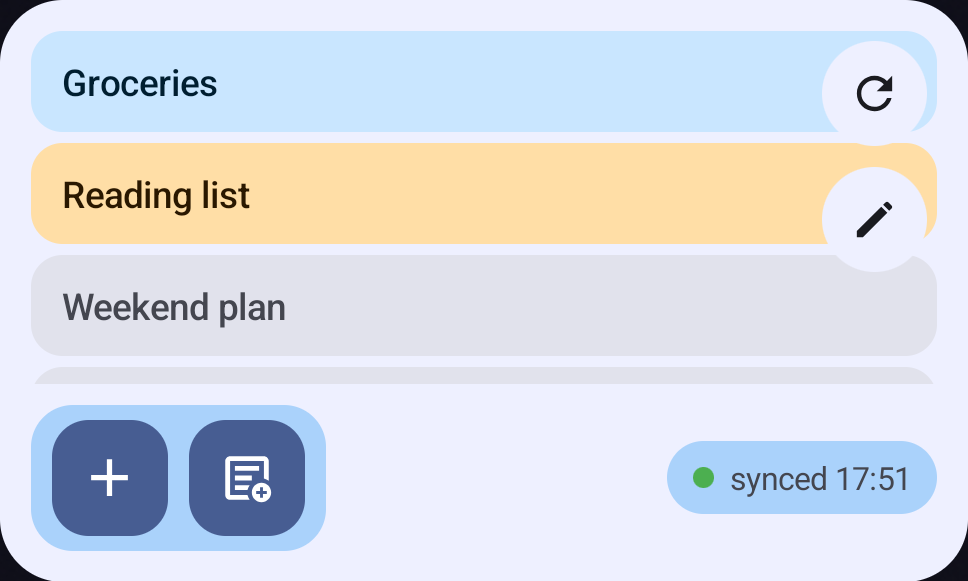

<p align="center">
  
</p>

<h1 align="center">Notes Widget for Markdown</h1>

<p align="center">
  Your Markdown notes on the Android home screen — and a chip that tells you when git sync broke.<br>
  <sub>No account, no backend. The <code>foss</code> build declares no <code>INTERNET</code> permission.</sub>
</p>

<p align="center">
  <a href="#install">Install</a> ·
  <a href="#how-to-use-it">How to use it</a> ·
  <a href="#sync-status">Sync status</a> ·
  <a href="#privacy">Privacy</a> ·
  <a href="https://github.com/marfolog/notes-widget-for-markdown/discussions">Discussions</a> ·
  <a href="LICENSE">GPL-3.0</a>
</p>

---

## What you get

<p align="center">
  
  &nbsp;&nbsp;
  
</p>

**Two widgets over the same folder.** Cards render a preview of each note — headings, links, lists,
task checkboxes. The compact list shows just names, so more notes fit. Tapping a note opens it in
Obsidian.

**A sync chip that means something.** It reads the vault's `.git` and says `synced 17:51`,
`sync stuck` when a merge or rebase was left half-finished, or `not pushed` when your branch drifted
from `origin`. Nothing else on your phone tells you sync quietly stopped.

**Notes that stay yours.** Plain `.md` files in a folder you pick, read through Android's Storage
Access Framework. The app does not copy or convert them, and has nowhere to upload them to.

**Cards you can arrange.** Per-note height, text size and colour; drag to reorder; swipe a card
aside to delete the file. Light and dark can be forced or left to the system.

## Install

Requires Android 11 (API 30) or newer.

**Google Play.** [Get it on Google Play](https://play.google.com/store/apps/details?id=com.marfolog.noteswidgetformarkdown).
This is the `play` build, which includes crash reporting.

**APK from GitHub.** No F-Droid listing yet.

1. Download the APK from [Releases](https://github.com/marfolog/notes-widget-for-markdown/releases)
   — take the `foss` one unless you want the Play build's crash reporting.
2. Allow installs from unknown sources when Android asks.

Every release lists a SHA-256 so you can check what you downloaded.

**Getting notified of new versions.** The app itself never checks — doing that would need the
`INTERNET` permission the `foss` build deliberately does not have. Two ways that don't need it:

- [Obtainium](https://github.com/ImranR98/Obtainium): add this repo once, and it watches GitHub
  Releases and notifies you when a new one lands, without the widget app itself going online.
- F-Droid, once listed there, updates the normal F-Droid way.

The `play` build updates through the Play Store like anything else installed from it.

## How to use it

1. Open the app and pick the **notes folder** — the one the widget should show. It can be the root
   of your vault or any subfolder. Everything else stays hidden until you have.
2. Add either widget to your home screen and resize it.
3. Come back to set card colours, sizes and order, and to say how you sync.

The app works the vault out on its own by looking for `.obsidian`, so the root folder only has to be
picked when that fails.

The widget shows the notes that sit directly in the folder you picked, not those in its subfolders.
When that folder has none, the app looks one more time (counting only, it reads no note) and tells you
why: your notes are in subfolders (it lists them with how many each holds, and **Pick a subfolder**
opens the folder picker right there), the folder has no Markdown files, or it is empty. The same
explanation shows in the first-launch guide, on the empty widget and in settings.

**Fast Note Target** is optional. Fast notes are added at the end of the file, nothing is overwritten.
You can choose **None, ask every time**, let the app create its own *Quick notes.md* in the notes
folder, or pick one of your own files; the app warns once before it takes a file that already has
content.

A note that lives somewhere else, like a single list in another folder, can be added on its own under
**Extra Notes → Add File**, one file at a time. It shows on the widget next to the folder notes.
Swiping it away only takes it off the widget; the file stays where it is.

Tapping a note opens it in Obsidian and the **+** button creates one there. Everything else —
reading, previewing, ordering, deleting — works without Obsidian installed.

## Sync status

If the vault is a git repository, the widget reports what git last did. The app does not run git and
does not open network connections. It reads the plain-text files a git client leaves behind:

| File | What it tells us |
| --- | --- |
| `logs/HEAD` | the last commit, pull, merge or checkout, and when |
| `FETCH_HEAD` | when a client last contacted the remote (timestamp only) |
| `index` | that a client is alive, even with nothing to transfer (timestamp only) |
| `MERGE_HEAD`, `rebase-merge`, `rebase-apply` | a merge or rebase that stopped — in practice a conflict |
| `HEAD`, `refs/**`, `packed-refs` | the current branch, and whether it matches `origin` |

It does not read commit contents, `config`, remote URLs or credentials. Because this is ordinary git
plumbing, it behaves the same with CLI git, Obsidian Git or Git Sync.

Two things worth knowing. The reflog only moves when something actually transfers, so a quiet vault
is normal rather than broken. And Storage Access Framework cannot look above a folder you granted —
if `.git` sits one level up, the app asks for that folder too.

Settings asks how you sync: **Git**, **Something else**, or **I don't**. Without git there is no
state to read, so the chip falls back to when a note last changed — enough to notice a sync that
died. You also choose how long the silence has to last before the chip turns amber.

## Privacy

The app ships in two flavours, and they differ in exactly one thing — whether anything leaves your
phone.

| | `foss` — GitHub, F-Droid | `play` — Google Play |
| --- | --- | --- |
| `INTERNET` permission | **no** | yes |
| Analytics | none | Firebase, app usage only |
| Crash reports | none | Firebase Crashlytics |
| Can be switched off | nothing to switch off | yes, in settings |
| Rating prompt | the app's own dialog after a saved note; it and the ★ Rate chip link to GitHub | Google's in-app review once, then the app's own dialog after a saved note; the dialog and the ★ Rate chip link to the store |
| Feedback you type | opens a GitHub discussion in your browser, the app sends nothing | Firebase Firestore, only when you press Send |
| "Would you use this?" in settings | not asked | one question, Firebase Firestore, only when you tap "Yes" or "No" |

**The foss build declares no `INTERNET` permission.** Without it, Android does not grant the app a
network connection of its own. That is a property of the file you download rather than an assurance
from me, and you can check it on your copy:
`aapt dump permissions app-foss-release.apk`. Opening a note still hands its location to Obsidian,
which is what the tap is for.

The app is built on roughly 190 third-party libraries, almost all of them AndroidX. I have not
audited them and cannot vouch for what any of them does — nobody shipping an Android app can. What
I can point at is the missing network permission above, and the dependency list in
[`docs/dependencies-foss.txt`](docs/dependencies-foss.txt), so you can judge for yourself.
It does ask for `WAKE_LOCK`, `ACCESS_NETWORK_STATE`, `RECEIVE_BOOT_COMPLETED` and
`FOREGROUND_SERVICE` — those come from WorkManager, which schedules the widget refresh, and none of
them can move data off the device. It also wakes on screen unlock, so what you see is current by
the time you look.

The Play build can report app and crash events, but only after you say yes. The first-launch guide
asks right after its welcome screen, with "Share anonymous stats" and "No thanks", and until you
answer nothing is sent. If you updated instead, or left the guide before answering, the question
comes later: on a visit to settings, or right after a saved quick note. It is asked once, and
you can change your answer in settings any time. It is written not to send note contents, file names or
folder paths: storage locations are stripped from crash messages and breadcrumbs before they are
handed to Firebase. No advertising ID is collected, and the ad-related
permissions Firebase would otherwise add are removed from the manifest.

Two days after the app first runs on your phone, a saved note, whether a quick note or a new one
from the widget, may be followed by a request for a rating. In the Play build the first is Google's
own in-app review card, asked for once; it goes through the Play Store app on your phone, Google
decides whether the card appears, and the app is never told whether you rated it or what you gave.
It only learns how long the card stayed open, in three rough buckets. Five days later the app's own
dialog follows, with a button to rate and a "Later" button; in the foss build it is the first
request, two days after the first start. The button only opens a page: the store page in the Play
build, the GitHub repository in the foss build. "Later", or closing the dialog, brings it back once,
ten days on; after the second "Later" it never comes again. Once you rate, from the dialog, the ★ Rate
chip on the widget, the "What's new" dialog or settings, nothing asks again. The ★ Rate chip and the
rate row in settings open the same page.

"Send feedback" in settings opens a form asking what you think and what to build next; settings
do not open it on their own. In the Play build, pressing Send stores your answer — the thumb and what you typed — together with the app
version in Firebase Firestore. Nothing is sent until you press Send, and nothing else goes with
it: no account, no device identifier, nothing from your notes. This does not depend on the
analytics switch, because sending is something you do on purpose. In the foss build Send only opens
a pre-filled GitHub discussion in your browser, where you decide whether to post it.

Once, after you have used settings a while, the Play build asks in a banner (and in the list of
subfolders, if your notes are in several) whether you would use widgets that each show a different
folder. A tap on "Yes, I'd use it" or "No thanks" stores one document in Firebase Firestore: the
feature's name, yes or no, the app version and the server's time, nothing else, no identifier of you,
your phone or your installation, no folder name. It goes out once per installation and does not
depend on the analytics switch, because tapping is something you do on purpose; the closing
button and ignoring the banner send nothing there (with your consent to statistics the
analytics only count them as "dismissed" or "ignored"). The foss build never asks.

Neither build has an account. Apart from the feedback and that one answer you choose to send from the
Play build, no server or database holds anything of yours. Files are read only in folders you picked.

Full text: [Privacy Policy](https://folmbuild.cz/notes-widget-privacy/).

## Limitations

- **Updates are not instant.** The widget redraws within seconds of Android telling it the folder
  changed — but Android decides when to tell it, and holds that back for apps you rarely open. A
  new note usually shows up in seconds, sometimes minutes. Exempting the app from battery
  optimisation makes it prompt. A widget over a folder someone else writes into can never match one
  over an app's own database, which is what Google Keep has.
- Not an official Obsidian plugin, and not affiliated with Obsidian.
- Reports sync state, never performs it — pulling and pushing stays with your client.
- No editing inside the widget; opening and creating go through Obsidian deep links.
- Android widgets cannot render full Markdown, so previews are simplified.
- Translated into Czech, German, Spanish, French, Italian, Portuguese, Russian, Ukrainian, Chinese
  and Japanese. See [Translations](#translations).
- For Obsidian Sync, Syncthing and similar there is no real status — those clients keep their state
  in private app storage no other app can read. The chip falls back to when a note last changed.

<details>
<summary><b>Build from source</b></summary>

Needs Android Studio, JDK 17+ and the API 36 SDK.

There are two flavours: `foss` (no Firebase, no `INTERNET`) and `play` (analytics, crash
reporting and sending feedback). Build the one you want.

```bash
./gradlew assembleFossDebug    # debug APK, no telemetry
./gradlew assemblePlayDebug    # debug APK with Firebase
./gradlew testFossDebugUnitTest
./gradlew installFossDebug     # install on a connected device
./gradlew assembleFossRelease  # release APK
```

Release builds are unsigned unless you supply `RELEASE_STORE_FILE`, `RELEASE_STORE_PASSWORD`,
`RELEASE_KEY_ALIAS` and `RELEASE_KEY_PASSWORD` through local Gradle properties or environment
variables. Never commit keystores or passwords.

Tagging `vX.Y.Z` builds and signs both flavours in GitHub Actions and attaches them to a Release
with their SHA-256 sums. The release fails if the foss APK ever gains the `INTERNET` permission —
the privacy claim is enforced by the pipeline, not by memory.

</details>

<details>
<summary><b>How it is built</b></summary>

Kotlin, Gradle Kotlin DSL, Jetpack Compose for settings, Jetpack Glance for the widgets, Koin,
Coroutines and Flow, Storage Access Framework via `DocumentFile`, CommonMark for the preview, and
WorkManager plus a JobScheduler content trigger for refreshes.

The rules the code sticks to: the file system is the source of truth, no database for note content,
no account, no cloud, and platform APIs over file-access hacks.

</details>

<details>
<summary><b>Roadmap</b></summary>

Nothing is promised. Things that would make sense if the project carries on: F-Droid metadata ·
configurable non-Obsidian editors · a grid layout for the card widget · notes from subfolders on the widget · dark
variants of the card colours, which stay light at night · an accessibility pass over widget
contrast and touch targets.

The one worth doing first is making refreshes prompt without asking anyone to touch battery
settings — see Limitations.

</details>

## Translations

Only the English and the Czech were written by someone who speaks the language well. The other
languages are machine-assisted translations, so some wording will be off. If something reads wrong
in your language, tell me in an [issue](https://github.com/marfolog/notes-widget-for-markdown/issues/new)
or in [Discussions](https://github.com/marfolog/notes-widget-for-markdown/discussions) — the screen,
what it says, and what it should say is enough. On Android 13 and newer you can pick the app's
language in settings, separately from the phone's.

## Feedback and contributing

- **Something broken?** [Open a bug report](https://github.com/marfolog/notes-widget-for-markdown/issues/new?template=bug_report.yml).
  The foss build sends no reports, so a report from you is the only way a crash gets seen.
  The form asks for your launcher and sync client because widget bugs almost always depend on them.
- **Want something?** [Open an idea](https://github.com/marfolog/notes-widget-for-markdown/issues/new?template=feature_request.yml)
  or bring it to [Discussions](https://github.com/marfolog/notes-widget-for-markdown/discussions)
  if it is still half-formed.

Pull requests are welcome. Most useful right now: testing against real vaults, Markdown preview edge
cases, and launcher compatibility reports — widgets behave differently on Pixel, One UI and Nova,
and I can only test one. Please open an issue before a large pull request.

## Support, honestly

I answer when I can. Sometimes that is the same day, sometimes it is a month, and sometimes this
project goes quiet for a while — it is written in evenings, next to a job. Issues stay open rather
than being closed to keep the tracker tidy, and a quiet issue is not a rejected one.

If it ever stops for good, your notes are unaffected — they are your own files in your own folder.
Uninstall the app and they stay where they are, in Markdown, readable by anything else. That is
the whole reason it reads a folder instead of keeping a database of its own — and it is the part
no abandoned app can take away from you.

## No warranty

This is a free, GPL-3.0-licensed hobby project maintained by one person in his spare time. It comes
**as is, without warranty of any kind**, and you use it at your own risk. Two things deserve saying
plainly rather than hiding in the licence text:

- **Deleting a note from settings deletes the file.** There is no trash to recover it from. If your
  vault is not backed up or version-controlled, it is gone.
- **The sync chip is informational.** It reports what it can read from `.git`, and it can be wrong
  or out of date — a client may write state the app does not understand. Never treat a green chip
  as proof that your notes are safely synced; check your git client when it matters.

Nothing here excludes liability where the law does not allow it to be excluded.

## License

GPL-3.0 — see [LICENSE](LICENSE). You may use, study, change and share it; if you distribute a
changed version, it has to stay under the same licence and its source has to come with it. The
licence also disclaims warranty and liability; the section above just says the same thing in plain
words.

**Linking exception.** As an additional permission under GPL-3.0 section 7, you may link this
program with the Google Play Services and Firebase libraries and distribute the result, even though
those libraries are not free software. This exists so the `play` flavour can be built and shipped
by anyone, not only by the copyright holder. The `foss` flavour contains none of them.
